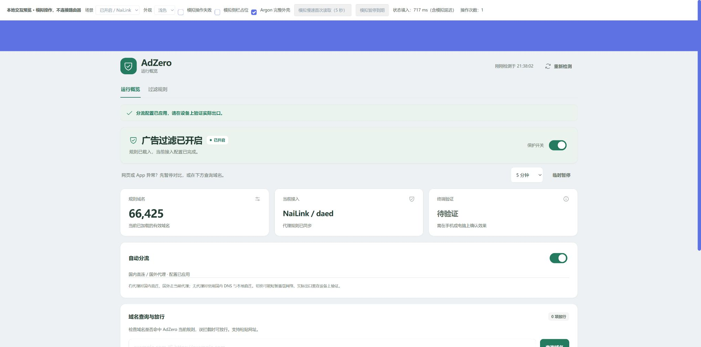

# AdZero

当前测试版 **v0.9.1** 修复 NaiLink request-only DNS 配置无法开启分流、网络短暂断线丢失任务回执的问题；NaiLink 分流正常切换减少到一次重载，增加阶段与用时反馈，并在配置与缓存内容均核验一致时复用缓存。详见 [开关响应修复记录](docs/INTERACTION_FIXES.md)。

面向软路由的原生 LuCI 插件，无独立后台和二次登录。复用 adblock-fast 处理规则，把同一份有效规则接入当前代理的 DNS 链路。

保留「自动分流」、规则库、自定义 HTTPS 订阅、域名查询、误杀放行和临时暂停。有运行中的受支持代理时协调国内 DNS/直连与国外 DNS/当前代理；无代理时使用国内 DNS 与本地直连。分流默认关闭，需先开启保护。NaiLink、PassWall、OpenClash、Nikki 使用各自原生入口；安装矩阵为 OpenWrt **24.10.8 x86/64（IPK）、25.12.5 x86/64（APK）、25.12.5 rockchip/armv8（APK）**，使用对应官方 SDK；真机和 LAN 验收仍需分别完成。

菜单名称为 **AdZero**。首屏异步读取当前状态，提供保护开关、临时暂停、域名查询和个人放行名单；不显示固件/CPU/未启用代理等诊断面板，也不虚构拦截次数。支持手机、深色外观、键盘操作和失败重试。

v0.8.1 修正既有匿名订阅删除后的回滚比较，避免把 UCI 自动重编号误判为外部修改；有其他页面尚未保存的后端配置时拒绝提交或覆盖。

智能分流的目标是由 AdZero 统一管理广告过滤、DNS 选择和连接去向：有可用代理时，国内默认直连、国外默认走当前代理；无可用代理时，所有未被拦截的请求使用国内 DNS 与本地网络直连。SmartDNS、AdGuard Home 只作为功能与交互参考，不作为新增运行依赖。详见 [修订后的设计与验收约束](docs/SMART_DNS.md)。v0.9.0 已加入四种适配器和无代理路径，实际能力、限制及验证范围见该文档。

## 规则库与自定义订阅

进入「过滤规则」，从 HaGeZi Light / Normal / Pro、anti-AD、AdAway 中按需添加，或填写自己的 HTTPS 地址。支持域名列表、Hosts 和 `||domain^` 基础 DNS Adblock；不支持网页元素、正则、修饰符或高级例外。不限于预置来源，但格式必须适合路由器域名过滤。

每项订阅可启用、停用或删除，关闭保护时保留选择；个人放行名单始终保留。建议同系列选一项，数量不代表实际拦截率。新订阅先下载校验，再处理并同步到当前接入；失败时尝试恢复原配置，有并发修改则保留恢复记录。任务在路由器后台运行，离开页面仍会继续，返回同一标签页可查看回执。

返回菜单时，当前登录会话内最近 5 分钟的概览可立即展示，并标明「上次状态」。后台核对完成前禁用修改，核对失败保留概览并提供重试。订阅地址、令牌和个人名单不会写入页面快照。首次进入、重新登录、快照过期或浏览器禁止存储时正常读取。详见 [规则管理说明](docs/RULE_SOURCES.md)。

## 查询、误杀放行与暂停

1. 输入域名或 HTTP(S) 网址，点击「查询域名」，查看是否命中当前已处理规则及具体命中域名。查询不访问输入的网址，不进行 DNS 探测；结果不是浏览记录，也不能代替实际终端验证。支持 ASCII/punycode 域名，不接受 IP、通配符、带账号密码的网址。
2. 命中后先阅读放行范围，再点击「放行此范围」。例如 login.ads.example 命中 ads.example，会明确提示**放行 ads.example 及其所有子域**。这是本版四种适配器共有的范围放行语义，不提供更窄的子域例外。服务端在操作锁内再次核对命中范围，规则已变化时拒绝应用。最多保存 100 项。
3. 展开「已放行」可随时撤销。名单保存在 /etc/config/adzero，关闭/暂停和标准 --upgrade 升级时保留；撤销后该域名是否再次被拦截，取决于当前规则。后端原有放行名单保留，关闭时恢复。
4. 网站或 App 异常时，可先「临时暂停」5、15、30 分钟做对比。暂停会移除 AdZero 自己的代理规则并停止自管过滤后端，保留当前 DNS/代理的原有配置；到期约 5 秒内开始尝试恢复，繁忙操作可能延后。也可「立即恢复」或「保持关闭」取消定时恢复。路由器重启会提前尝试恢复保护。

应用/撤销放行会重新下载和处理当前规则，需要网络，可能重启 DNS 或代理；执行期间请等待状态确认。查询和名单管理在保护已开启且规则就绪时可用。放行只移除 AdZero 自己的拦截，其他插件/订阅的独立规则、浏览器或终端缓存仍可能影响结果。

恢复失败会保留暂停/恢复记录并明确显示；不会显示成已开启。计时使用启动时钟而非系统日期，避免校时改变期限。不要手动删除 /etc/adzero 的恢复记录。交互说明见 [UI_DESIGN.md](docs/UI_DESIGN.md)，验收边界见 [LOCAL_VALIDATION.md](docs/LOCAL_VALIDATION.md)。

## 一键安装

在匹配上述固件版本与 target 的路由器上，以 root SSH 执行：

~~~sh
curl -fL --proto '=https' --proto-redir '=https' https://raw.githubusercontent.com/slobys/AdZero/v0.9.1/scripts/install.sh -o /tmp/adzero-install.sh && sh /tmp/adzero-install.sh
~~~

安装器核对固件版本、target、包管理器、软件包架构及 SHA-256；备份 /etc/config，安装依赖，然后启用保护。未列入发行清单的固件或架构会停止安装。HTTPS 方式需要 curl，也可下载 [测试发行包](https://github.com/slobys/AdZero/releases/tag/v0.9.1)，解压后执行：

~~~sh
sh install.sh --local-dir "$(pwd)"
~~~

加 --no-enable 可只安装，之后在「服务 → AdZero」开启。**已有版本可使用 --upgrade：先校验安装包、备份配置及恢复记录，再调用旧版关闭、安装并重新开启。**

~~~sh
curl -fL --proto '=https' --proto-redir '=https' https://raw.githubusercontent.com/slobys/AdZero/v0.9.1/scripts/install.sh -o /tmp/adzero-install.sh && sh /tmp/adzero-install.sh --upgrade
~~~

升级后刷新 LuCI 页面；旧资源缓存未更新时可用 Ctrl+F5 强制刷新。

旧版短暂占锁时，升级器最多等待 30 秒重试；只重试旧版明确的“另一项操作正在进行”提示，其他恢复失败立即停止。锁持续占用则停止安装并保留配置、锁和恢复记录。请先提供 `ls -la /tmp/adzero.lock` 与 `ps w | grep -E '[a]dzero/(ctl|watch|adapter|backend)'` 的只读结果，不要直接删除锁。升级备份中的 state.tar.gz 可能含原有 DNS 配置，请仅保留在路由器本地。

rockchip/armv8 的固件/SDK 架构名为 aarch64_generic；APK 的 --print-arch 可能返回 CPU 名 aarch64。安装器只对已列入矩阵的该目标接受这组明确别名，仍严格匹配固件、target 和包类型。旧版 v0.5.0 只提供 x86；遇到 target 不支持时请使用上面的 v0.9.1 地址。

v0.5.3 已修正「规则已加载成功却被判失败回滚」；v0.5.2 已修正旧默认规则源；v0.6.0 已解决 LuCI 将 disabled=false 写为实际禁用属性的问题。缺少 gawk、GNU grep/sed、coreutils-sort 仍为后端推荐提示，本版未因此新增依赖。

安装依赖使用固件自己的软件源，不升级整套固件。依赖下载需要联网；离线发行包没有捆绑所有依赖。当前 APK 为开发者未签名包，安装器只对通过 SHA-256 检查的本地 APK 使用 --allow-untrusted。SHA-256 防止文件损坏，下载可信度依赖 GitHub HTTPS。

## 已实现的适配

| 代理 | 原生接入点 | 当前验证 |
| --- | --- | --- |
| NaiLink / daed | 通过 LuCI CGI/GraphQL 给当前 DNS 的 request 路由增加自有 reject 规则；在 /etc/daed 保存 GeoSite DAT | dae 解析/DAT 通过；用户反馈 v0.5.3 Rockchip 真机启用及 API 配置同步成功，LAN/eBPF 过滤效果待测 |
| PassWall | /etc/passwall/rules/block_host 的自有标记区块，以及 use_block_list | 实际 ucode/UCI 的应用、恢复和失败回滚检查；真机待测 |
| OpenClash | 官方 custom_overwrite 钩子；仅修改生成的运行配置，调用 Meta 内核检查 | 实际 Ruby YAML/锚点处理通过，Mihomo DNS 实测通过；真机待测 |
| Nikki | 原生 mixin.yaml、mixin 开关及必要的 Fake-IP 列表合并 | 实际 yq/UCI 混入与恢复通过，Mihomo DNS 实测通过；真机待测 |

Mihomo 在普通和 Fake-IP 模式下的 UDP/TCP、A/AAAA 共 40 组本机查询通过（覆盖拦截、放行、暂停、恢复、撤销五种配置）：被测广告域名返回 NXDOMAIN，正常域名保持可用。测试使用真实 v1.19.32 内核与隔离的本地 DNS 上游，不经过家庭网络。Nikki/OpenClash 的不同内核版本仍需要分别验收。

多代理同时开启、未知代理内核、Nikki core_only、现有禁用但非空的 Nikki 混入、Fake-IP 白名单模式，以及无法等价保留的放行例外会拒绝自动修改。PassWall 2 目前只识别，不自动适配。

## 工作方式和恢复

- 自动分流开启后，在现有原生入口增加国内分类与连接路由，不引入 SmartDNS/AdGuard Home。国内分类首次从固定提交下载并校验 SHA-256，之后使用本地缓存；升级不会自动开启分流。分类库与广告订阅各自管理。
- 无可用拦截源时准备 HaGeZi Light；已有规则优先使用。适配器只读取 adblock-fast 已处理、非空的域名规则，不另行下载另一套规则。
- 使用原生扩展入口，不添加 DNS 服务器，不改 DHCP、DNS 监听端口或自行添加防火墙劫持。代理原有的 DNS/防火墙行为保持由代理管理。
- 开启会保存并临时设置 force_dns=0 和严格 HTTPS 证书验证，关闭时恢复未被外部改变的选项。
- 开启、更新可能重启当前 DNS/代理服务，短暂影响连接。只有一个启用或运行中的受支持代理才自动接入。
- /etc/adzero/adapter.json 保存恢复日志，权限 0600，可能含原有 DNS 配置，应保留在路由器上。重复同步且内容不变时不重启代理、不反复写配置。
- 启动/更新失败会尝试恢复；恢复失败保留记录并报告异常。用户修改的列表区块会保留；混入等配置存在并发修改时拒绝覆盖，等待检查。
- procd 任务每 60 秒检查规则更新及代理切换。关闭或卸载先恢复自有入口，再停止自管后端。不要手动删除恢复日志。
- 手动操作遇到锁默认等待最多 30 秒；后台同步遇到占用安静跳过。新锁以 owner 文件记录 PID 和动作，退出时只释放自己的锁；不会按超时或 PID 是否存在自动清除遗留锁。
- 状态输出包含只读 backend 检查结果；旧的 statusSuccess 或仅有 UCI 开关不会被当作当前后端正常。规则下载后由后端写入的数字 size 元数据不算用户修改，关闭时可清理本次自建且未改动的默认源。

~~~sh
/usr/libexec/adzero/ctl status
/usr/libexec/adzero/ctl enable
/usr/libexec/adzero/ctl refresh
/usr/libexec/adzero/ctl disable
~~~

界面显示「配置完成、终端待验证」，没有虚构拦截次数。AdGuard Home 运行或 adblock-fast 已由其他工具管理时，拒绝接管。

## 开发与验证

路由器端使用 BusyBox shell、ucode、现有代理自身的 Ruby/yq，不捆绑代理内核，不新增大型常驻引擎。依赖为 luci-base、adblock-fast、rpcd-mod-file、rpcd-mod-ucode、ca-bundle、curl 和 ucode 的 fs/uci/ubus 模块。

~~~sh
sh scripts/check.sh
python3 scripts/check_openwrt_runtime.py
# 在 Linux/WSL 的隔离 chroot 中验证 RPC，需要 root
python3 scripts/check_rpc.py
# 以下三项需要 ADZERO_UCODE 指向真实 ucode 命令（含 -L 模块目录）
python3 scripts/check_dns_core.py
python3 scripts/check_dae.py
python3 scripts/check_rule_source.py
python3 scripts/check_source_catalog.py
# 指定 ADZERO_TEST_SHELL 可用真实 OpenWrt ash 复现上游钩子返回值
python3 scripts/check_backend_hooks.py
~~~

[功能评估与建议](docs/FEATURE_REVIEW.md) · [验证记录](docs/LOCAL_VALIDATION.md) · [DNS 适配设计](docs/DNS_ADAPTERS.md) · [SDK 构建](docs/PACKAGING.md) · [兼容矩阵](docs/COMPATIBILITY.md) · [设备验收](docs/DEVICE_ACCEPTANCE.md)

[GitHub Actions](https://github.com/slobys/AdZero/actions) 提供隔离测试及上述三个官方 SDK 组合的真实构建。离线 build_ipk.py 仅用于归档检查，不用于公开安装清单。WebCodex 源码导入记录见 [SOURCE_IMPORT.md](docs/SOURCE_IMPORT.md)。

check_rule_source.py 每次通过严格 HTTPS 下载包内配置的默认规则，用生产 ucode 解析器和固定版本 adblock-fast 的域名过滤表达式校验，避免只测模拟后端而遗漏失效链接。该检查不启动 DNS 服务、不修改 UCI；它证明开发/CI 网络当时可下载，仍需路由器自身网络验收。

## 后续兼容范围

ImmortalWrt、iStoreOS、其他 ARM 目标，以及 MIPS、RISC-V 等依照 [机器可读矩阵](docs/compatibility-matrix.json) 逐项推进。即使 LuCI 包声明 all，也不代表依赖和固件 ABI 通用；安装器不会仅凭 CPU 位数跨固件装包。

DNS 过滤无法可靠去除同域视频广告或网页占位。终端自行使用 DoH/DoT、外部 DNS 或绕过路由器的流量可能不受保护。下一步以实际设备上的启停、重启、订阅更新、IPv4/IPv6 和 LAN 查询证据决定稳定版范围。

源码使用 MIT 许可证；adblock-fast、代理插件与规则源保留各自许可。
