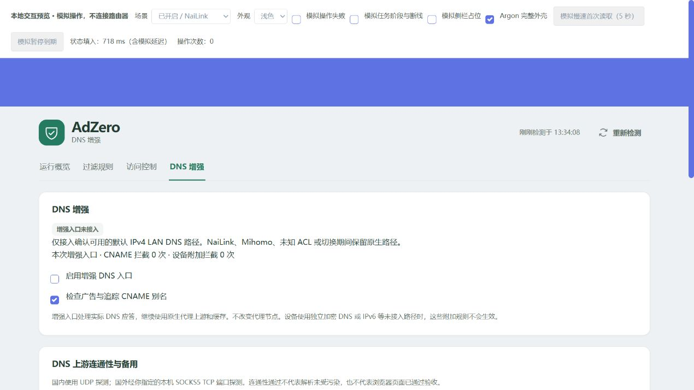

# DNS 增强功能设计与边界

本轮增加规则来源、临时放行、上游探测与组内备用、CNAME 应答过滤、设备附加策略。

## 日常操作

- 在「DNS 增强 → 上游与备用」直接查看和编辑两组 DNS。每行一个 IP，每组最多八个，首条优先，其余为备用；保存到待应用后，再点页面顶部「应用并重新加载」。自动分流关闭时仅保存地址，需要启用分流请到概览设置并统一应用。
- 在「访问控制」查询域名，可查看已确认的命中来源，选择永久放行待应用，或直接临时放行 10 分钟／1 小时。到期失败时保留例外并重试；保护关闭期间不重新开启网络，下一次开启前核对过期例外。
- 在「DNS 增强」设置中保存当前代理提供的**本机无认证 SOCKS5 端口**。不自动猜测端口、选择节点或读取凭据。未填写时跳过国外测试。测试结果是该端口的连通性，并不证明它与代理其他 ACL 使用相同节点。
- 「测试 DNS」按国内 UDP、国外 SOCKS5 TCP 展示结果；当前版只测试普通 DNS 53 端口，暂不接受 DoH/DoT 地址。测试端口必须是当前代理实际提供的本机 SOCKS5 端口，不能填 DNS 端口。修改端口／增强设置后点「保存增强设置」，再测试；未保存、未应用时会明确提示。地址或国外端口变化后，旧耗时显示「需重测」。
- 自动备用需要已开启 AdZero 自动分流。连续三轮检查失败且同组有可用地址才尝试切换，至少冷却五分钟；保留原有批量事务、冲突检查与回滚。
- CNAME／设备附加规则还需启用「增强 DNS 入口」。当前支持默认 IPv4 LAN → 路由器 DNS，以及已确认的 PassWall 默认 DNS 路径。NaiLink eBPF、OpenClash/Nikki、IPv6、自定义 PassWall ACL 暂不接入增强入口，原有广告过滤继续使用。
- 按固定 IPv4 添加设备，设置该设备附加拦截／附加放行。附加放行不能撤销全局列表或其他插件的拦截；需要全局解除时使用「访问控制」。设备更换 IP 后应同步修改策略，建议使用 DHCP 静态租约。

增强入口不创建共享 DNS 缓存、不保存完整查询日志。它的 CNAME／设备拦截计数单独展示，不加到可能重叠的被动观察总数中。

## 本轮修改的主要文件

- `policy.uc`、`ctl`、`watch`：临时放行、到期恢复和回滚。
- `provenance.uc`、`source-cache.uc`：当前生效来源的摘要核对与低开销查询。
- `dns-enhance.uc`、`dns-enhance-lib.uc`、`dns-relay.uc`、`dns-io.uc`：增强入口、设备策略、DNS 解析检查与备用检测。
- `etc/init.d/adzero`：按需启动增强实例，退出清理自己的接管。
- LuCI `overview.js/css`、rpcd `adzero` 和 ACL：独立菜单、类型化接口与访问权限。
- 构建与验证脚本：新增小型 socket 模块依赖及原生网络隔离测试。

## 界面预览

下图使用真实 LuCI 页面与模拟 RPC，仅展示交互和布局，不是路由器生效证据。

## 实现顺序

1. 在既有访问控制事务中加入临时例外，使用启动标识和单调时钟，到期批量恢复，失败保留日志并重试。
2. 使用当前输出摘要和已应用来源凭据解释命中；不把当前下载缓存直接当作生效来源。
3. 以小型 ucode socket 模块实现有界的 DNS 探测和增强入口，不新增大型 DNS 服务。国内 UDP；国外通过明确配置的本机 SOCKS5 TCP 端点探测。缺少端点时不把直连测速当代理测速。
4. 增强入口仅在可确认的系统 DNS 或 PassWall 默认 IPv4 LAN 路径接入，保留原生上游与分流。未知 ACL、多代理、代理切换中、NaiLink eBPF、Mihomo Fake-IP 不猜测接管。
5. CNAME 只检查当前应答中由问题名称可达的别名链；设备附加名单按明确 IP 匹配。设备放行仅豁免该设备的附加拦截，不覆盖全局和其他插件原有规则。

## 网络和数据约束

- 增强入口默认关闭；不修改代理节点、用户防火墙表或全局连接记录。接管仅使用 AdZero 自己的 nft 表。
- 接管前先监听并确认原生 DNS 上游；退出、暂停、切换、进程停止时移除自己的表。服务不可用时放回原生路径。
- 不添加另一层 DNS 缓存；原生缓存继续生效，避免设备策略或临时规则被共享缓存跨设备复用。
- 原始 UDP/TCP DNS 透传，保留 EDNS；过滤时清除 DNSSEC AD 位并返回零 TTL 的空答案。
- 有界连接、消息、别名深度和上游等待；客户端身份只用于本地策略，不保存完整查询日志。
- 备用只在同组内选择。自动切换需连续失败、可用备用和冷却，不因一次慢查询重载代理。
- 隔离测试和 SDK 构建不能代替用户路由器与原电脑验收。
