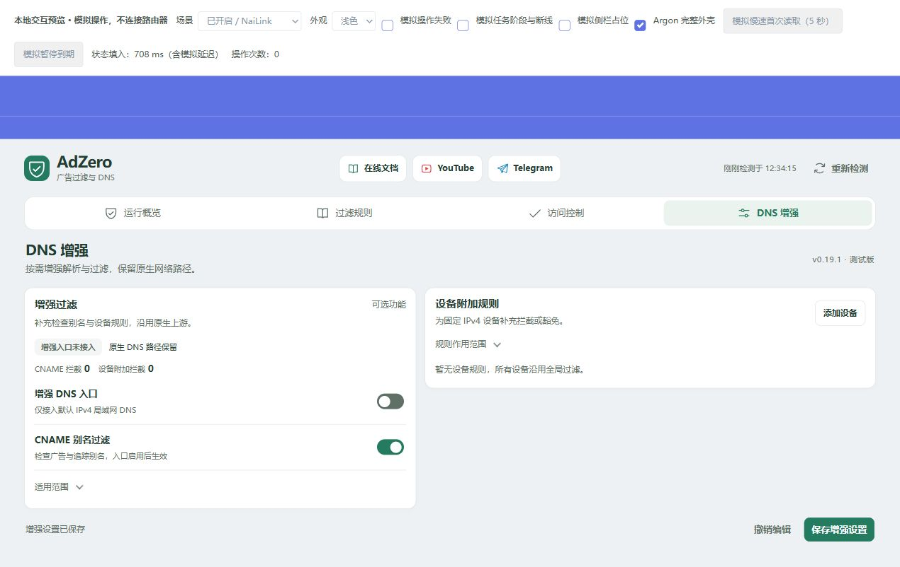
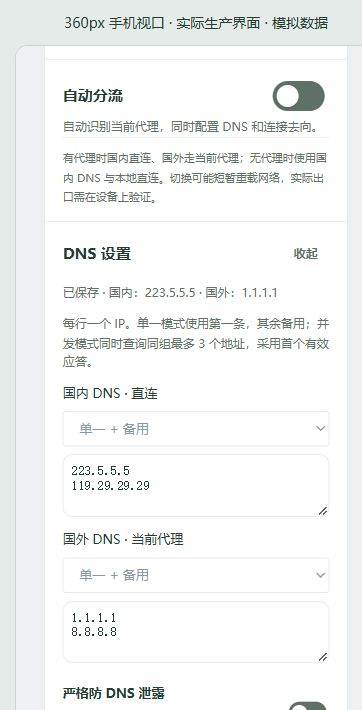

# DNS 设置与手动规则校验

v0.15.6 保留 PassWall 原有的 dnsmasq 或 ChinaDNS-NG 分流引擎，不再把 ChinaDNS-NG 静默切成 dnsmasq。广告过滤通过 PassWall 自己的屏蔽名单接入。自动分流打开时，使用这里选择的国内、国外 DNS；原生默认节点和 ChinaDNS-NG 分组策略仍保留。其他引擎不强制转换，自动分流无法适配时会在应用前说明原因。

旧版记录显示 DNS 引擎曾由 AdZero 改写时，仅在当前值仍与该记录一致的条件下恢复原引擎。后来的手动选择不覆盖；恢复记录继续保留，失败可回退。PassWall 自定义 ACL、切换期间的原始系统 DNS、客户端已缓存的错误答案及独立 nftset 异常，仍需在设备上分别验证。

## 统一配置入口

在「运行概览 → DNS 与分流 → DNS 设置」编辑国内／国外地址、查询策略、严格模式和本机 SOCKS5 端口。v0.19.1 起，测试 DNS 和自动备用也在这个入口；增强页已移除“上游与备用”，只保留过滤入口、CNAME 和设备附加规则。

- **单一 + 备用**：第一条参与查询，其他地址仅备用，每组最多八个。需要自动切换时，在同一 DNS 编辑器显式启用自动备用。
- **组内并发**：最多三个地址同时参与查询，首个有效应答胜出；国内和国外分别进行，不跨组竞争。失败、格式异常或查询不匹配的应答不会胜出，但有效应答不等于经过 DNSSEC／防污染认证。
- **统一应用**：先保存到待应用，再与规则、分流开关一起应用。严格模式会同时选择自动分流。关闭分流时普通 DNS 编辑只保存设置。

默认国内 `223.5.5.5`、备选 `119.29.29.29`；国外 `1.1.1.1`、备选 `8.8.8.8`。升级不自动开启并发或严格模式。这里接受标准 53 端口的 IPv4／IPv6 数字地址，不接受 DoH/DoT URL；两组实际参与查询的地址不可重叠。

## 各代理的并发能力

| 接入 | 国内并发 | 国外并发 | 严格模式条件 |
| --- | --- | --- | --- |
| OpenClash / Nikki | 内核原生多上游 | 每个上游绑定现有代理组 | DNS 已运行、可确认监听端口、唯一活动代理 |
| NaiLink | 本机有界 TCP 并发 | 本机 TCP 并发，保留原生 DNS 缓存 | 必须填写并验证当前 NaiLink 的无认证 SOCKS5 端口 |
| PassWall | 本机 TCP 并发，保留 dnsmasq / ChinaDNS-NG | 要求原生 `dns_mode=tcp` 和经验证的本机 SOCKS5 端口 | 默认 LAN、无启用的自定义 ACL、原生 DNS 接管与本机代理开启 |
| 无代理 | dnsmasq 原生多上游 | 不使用 | 不支持严格模式 |
| SSR Plus+ | 保留原生配置 | 保留原生配置 | 目前仅基础广告过滤 |

PassWall 的国外并发，以及严格模式中的原生 TCP DNS，均要求填写并验证本机 SOCKS5 端口，防止透明代理模式或端口排除导致直连。PassWall 的 Xray／sing-box DNS 模式不能直接填写多个远端地址。此版拒绝不支持的国外并发组合，保留原引擎，不会静默改成 TCP 或替换节点。NaiLink 的本机转发器不增加共享缓存；OpenClash / Nikki 保留原有 Fake-IP 和节点选择。并发会增加上游请求量，未必快于已经命中本地缓存的查询。

## 严格 DNS 防旁路的范围

严格模式是路由器上的**路径约束与故障阻断**，不是“所有应用、所有接口、端到端加密”的保证：

1. 只支持可确认的单个默认 IPv4 LAN、单个端口 53 的 dnsmasq 和唯一活动代理。安装独立的 AdZero nftables 表，将该 LAN 的 IPv4 UDP/TCP 53 查询送入已确认路径。
2. 代理未确认、切换、恢复过程中保持该 LAN DNS 阻断；通过 UDP 与 TCP 应答检查后才开放。旧 UDP 连接只按实际 LAN 客户端与路由器的精确 DNS 五元组清理，不全局清 conntrack。旧 TCP DNS 映射会收到重置后重建。
3. 阻断该 LAN 的 IPv6 DNS 53 和 TCP/UDP 853，保留普通 IPv6 数据流量；不接管其他 VLAN、VPN、外部网关或未经过该路由器的数据。
4. 路由器对外的公共 53／853 查询受限，**国内生效组保留为代理节点引导解析例外**。这不是零 DNS 外发承诺；其他进程显式查询该例外地址也不在“国外组不直连”的保证内。
5. 国外组经当前代理，代理不可用不回落到国内组。普通 TCP DNS 本身不加密；代理传输是否加密由代理协议决定，节点出口到 DNS 上游的一段仍可能是普通 DNS。
6. 浏览器／应用 DoH 使用 HTTPS 443，不能无差别阻断而保持网页正常。请在设备侧关闭独立安全 DNS，或用受管理策略统一指定可信 DoH。此版不做 HTTPS 解密，也不声称覆盖任意内置 DoH。

严格模式需 `nft` 和安装依赖中的 `conntrack`。暂不同时接入可选 CNAME／设备附加入口，临时暂停也不可用；关闭并恢复仍受支持。若需要原生自定义 DNS 例外或复杂 ACL，请保持普通模式。

## 切换与恢复

严格模式保持启用时，先停止旧代理内核，再开启唯一新代理。后台发现接入变化时先阻断 DNS，通常在下一轮五秒检查中发起迁移；恢复时长仍取决于原生代理。多代理、未知状态或 UDP/TCP 检查失败会继续阻断并显示原因，不用直连冒充成功。

恢复记录使用 `/etc/adzero/dns-guard.json`。OpenClash 原生停止会恢复它保存的 DNS；只有值与已记录的原生快照或目标端口完全一致时才允许交接。若 OpenClash 把 AdZero 旧端口写入自己的生成备份，只修正该精确匹配的备份。手动修改不覆盖；遇到冲突保留记录，请通过页面关闭并恢复，不要手删恢复文件、防火墙或锁。

路由器不能清除电脑已缓存的坏答案。新查询路径修好后，旧缓存仍可能需要到期或在终端清理；不会向终端强推清缓存命令。

## 减少重复处理

- 只编辑备选库而不更换当前地址时，仅保存配置，后台巡检也不因此重载代理。
- 关闭分流时保存 DNS，不下载广告规则、不重载代理。
- NaiLink、已接入的 PassWall 更新分流或当前 DNS 时使用同一事务，保留广告规则；不再先退出整个接入再重新开启。异常时仍走回退流程。
- 域名规则和 DNS 一起更改时仍使用同一批量事务。其他代理保留现有恢复再应用路径，不能承诺全部插件都只重载一次。
- DNS 与广告规则分别检查并发修改；失败时恢复之前的 DNS 选择及原生配置。重载结果未确认时保留恢复记录，不清除后重新提交。

DNS 选择保存在 `/etc/config/adzero` 的 `dns_profile` 选项中。界面显示当前草稿与已保存状态，订阅地址和 DNS 草稿不写入浏览器会话快照。

## 手动规则校验

「过滤规则 → 手动校验」仅重新解析启用订阅的本地下载快照，更新数量与检查时间，不下载订阅，也不重建 DNS 或重载代理。没有有效本地快照时会提示先更新订阅，不把未检查的数据标为有效。

平常重新加载或更新得到相同正文时，复用之前的解析结果。新增小份缓存回执，避免每次把整份域名数组读回内存；复用时保留原检查时间。旧缓存首次读取后补齐回执，不重写大份正文与数组。

首次下载、内容变化、缓存损坏时仍检查基本格式、大小与数量，实际后端产物和运行状态也继续核对。HTTPS 下载证书检查继续保留。手动校验更新的统计不会把未应用的下载内容标记为当前过滤规则，也不会单独触发下次启动的全量下载。

## 验证边界

真实 UCI/ucode 的事务与四代理配置测试、真实 rpcd、NaiLink CGI/API-only 检查，均在隔离环境运行。Mihomo 在独立网络命名空间验证默认与自定义 DNS 的查询、广告拦截和连接去向，DNS/SOCKS/HTTP 上游是本地夹具；dae 检查默认、自定义 IPv4 和 IPv6 的实际配置解析。

v0.19.1 使用当前界面与保存的原生 LuCI DOM，验证桌面统一编辑、前置限制提示、一次批量提交及同页测试；RPC 与运行状态为模拟。360 像素手机视口检查了单列表单布局，没有进行完整手机端应用验收。截图：





实际路由器上游可达性、代理内核重载耗时、LAN DNS 路径和过滤效果仍需设备验收。SDK 构建和隔离测试不等同于这些结果。

## 推荐设置与 SOCKS5 端口

每组先用两个地址即可：国内 `223.5.5.5`、`119.29.29.29`；国外 `1.1.1.1`、`8.8.8.8`。这是起点，快慢以实际网络与节点测试为准，不保证某家始终更快。并发采用首个有效应答，不验证 DNSSEC 或污染；普通 TCP 也不等于 DoH/DoT。

| 当前代理 | 建议先采用 | 严格模式 | 本机 SOCKS5 |
| --- | --- | --- | --- |
| NaiLink | 国内并发、国外并发，自动备用关闭 | 没有可用本机 SOCKS 服务时保持关闭 | 不是“节点与订阅”里远端 SOCKS 节点的端口；当前版本若无本地监听，留空，普通并发仍可使用 |
| PassWall，Xray／sing-box DNS | 国内并发、国外单一 + 备用，保留原引擎 | 基础网络和 UDP/TCP 正常后再开启；默认接管、本机代理须开启且无自定义 ACL | 国外并发不能只填端口解决；该组合要求原生 TCP DNS，不建议为并发盲目换引擎 |
| PassWall，原生 TCP DNS | 两组并发，先核对可用本机 SOCKS | 基础检查通过后可开启 | 国外并发及严格 TCP 模式必填真实无认证端口 |
| OpenClash | 两组并发，保留原有 Fake-IP、节点和代理组 | 基础检查通过后可开启 | 并发／严格本身不需要；仅国外测试使用 |

先选择并发与地址并应用，确认普通站点和广告测试正常，再单独开启严格模式并应用；避免一次改动过多而难以定位。不要为使用这套设置更换已正常的代理节点。严格模式范围及浏览器 DoH 限制见上文。

OpenClash 在「插件设置 → 流量控制」查看 SOCKS5 或混合端口；PassWall 在「基本设置／SOCKS 配置」核对实际启用的本机监听。不同版本字段不同，可用下面的只读命令核对候选值：

```sh
# PassWall：不同版本使用其中一个名称；值缺失不代表 1070 可用
uci -q get 'passwall.@global[0].node_socks_port'
uci -q get 'passwall.@global[0].tcp_node_socks_port'
# OpenClash：仅用于测试时需要
uci -q get openclash.config.socks_port
uci -q get openclash.config.mixed_port
# 确认候选端口实际监听；监听不等于已通过 SOCKS 协议和 DNS 检查
netstat -lnt
```

只有确认 `127.0.0.1:候选端口` 可用、无认证且属于当前代理时，才填到 AdZero。无需对 WAN 开放。示例 1070 不是通用默认值；DNS 53、管理网页、HTTP-only 和透明代理端口不能代替 SOCKS5。不要粘贴完整节点或含密码的配置。

官方实现参考：[PassWall 本机 SOCKS 候选](https://github.com/Openwrt-Passwall/openwrt-passwall/blob/main/luci-app-passwall/luasrc/model/cbi/passwall/client/global.lua)、[OpenClash 端口设置](https://github.com/vernesong/OpenClash/blob/master/luci-app-openclash/luasrc/model/cbi/openclash/settings.lua)、[NaiLink 远端 SOCKS 节点表单](https://github.com/slobys/NaiLink/blob/main/apps/web/src/components/ConfigureNodeFormModal/Socks5Form.tsx)。
