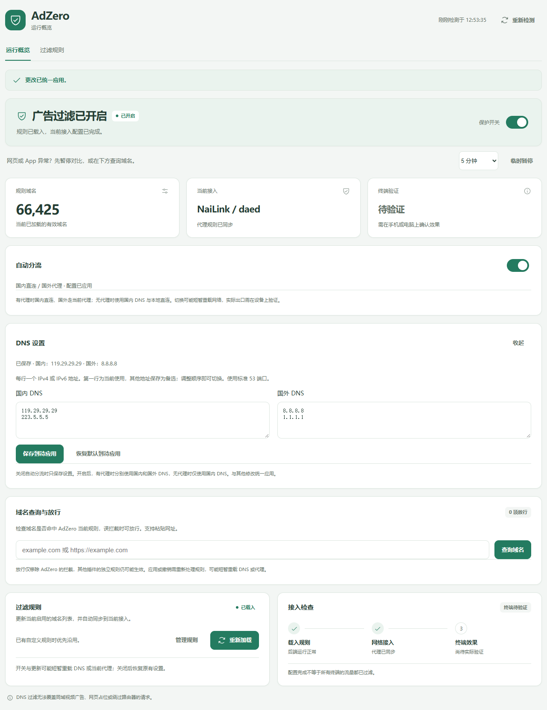
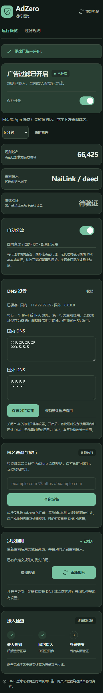

# DNS 设置与手动规则校验（v0.11.0）

## 日常操作

在「运行概览 → DNS 设置 → 编辑 DNS」中修改地址库，每行一个 IPv4 或 IPv6 地址。每组第一行是当前使用的 DNS，其余地址仅作为可编辑的备选库保存；调整顺序即可切换。备选项不代表并行查询、故障自动切换或自动测速。

| 分组 | 默认当前使用 | 默认备选 |
| --- | --- | --- |
| 国内 DNS | 223.5.5.5 | 119.29.29.29 |
| 国外 DNS | 1.1.1.1 | 8.8.8.8 |

本版统一使用标准 53 端口：国内 UDP，国外 TCP。支持 1–8 个不同的 IP 地址，不接受 DoH/DoT URL、域名、任意端口、回环、未指定或组播地址。国内与国外的当前地址不能相同，否则无法分别指定 DNS 连接路径。

点击「保存到待应用」后，与分流开关、广告规则一起点击一次「应用并重新加载」。「恢复默认到待应用」也只准备草稿，不立即改变网络。关闭分流时只保存设置，下一次开启时才使用；关闭广告保护后保留个人 DNS 选择。

有受支持代理时，国内域名使用国内 DNS，国外域名使用国外 DNS 并沿当前代理路径；无代理时只使用国内 DNS 与本地直连。现有 NaiLink、PassWall、OpenClash、Nikki 适配继续保留。本版没有增加 DNS 服务器或修改 DHCP 下发地址；沿用既有原生接入方式。

## 减少重复处理

- 只编辑备选库而不更换当前地址时，仅保存配置，后台巡检也不因此重载代理。
- 关闭分流时保存 DNS，不下载广告规则、不重载代理。
- NaiLink 分流已开启时，只切换当前 DNS，不重建广告后端；一次事务只提交一次代理重载。
- 域名规则和 DNS 一起更改时仍使用同一批量事务。其他代理保留现有恢复再应用路径，不能承诺全部插件都只重载一次。
- DNS 与广告规则分别检查并发修改；失败时恢复之前的 DNS 选择及原生配置。重载结果未确认时保留恢复记录，不清除后重新提交。

DNS 选择保存在 `/etc/config/adzero` 的 `dns_profile` 选项中。界面显示当前草稿与已保存状态，订阅地址和 DNS 草稿不写入浏览器会话快照。

## 手动规则校验

「过滤规则 → 手动校验」仅重新解析启用订阅的本地下载快照，更新数量与检查时间，不下载订阅，也不重建 DNS 或重载代理。没有有效本地快照时会提示先更新订阅，不把未检查的数据标为有效。

平常重新加载或更新得到相同正文时，复用之前的解析结果。新增小份缓存回执，避免每次把整份域名数组读回内存；复用时保留原检查时间。旧缓存首次读取后补齐回执，不重写大份正文与数组。

首次下载、内容变化、缓存损坏时仍检查基本格式、大小与数量，实际后端产物和运行状态也继续核对。HTTPS 下载证书检查继续保留。手动校验更新的统计不会把未应用的下载内容标记为当前过滤规则，也不会单独触发下次启动的全量下载。

## 验证边界

真实 UCI/ucode 的事务与四代理配置测试、真实 rpcd、NaiLink CGI/API-only 检查，均在隔离环境运行。Mihomo 在独立网络命名空间验证默认与自定义 DNS 的查询、广告拦截和连接去向，DNS/SOCKS/HTTP 上游是本地夹具；dae 检查默认、自定义 IPv4 和 IPv6 的实际配置解析。

浏览器使用当前界面与保存的原生 LuCI DOM，在桌面与 360 像素深色窄屏验证编辑、一次批量提交和手动校验，RPC 和运行状态为模拟。截图：

实际路由器上游可达性、代理内核重载耗时、LAN DNS 路径和过滤效果仍需设备验收。SDK 构建和隔离测试不等同于这些结果。
