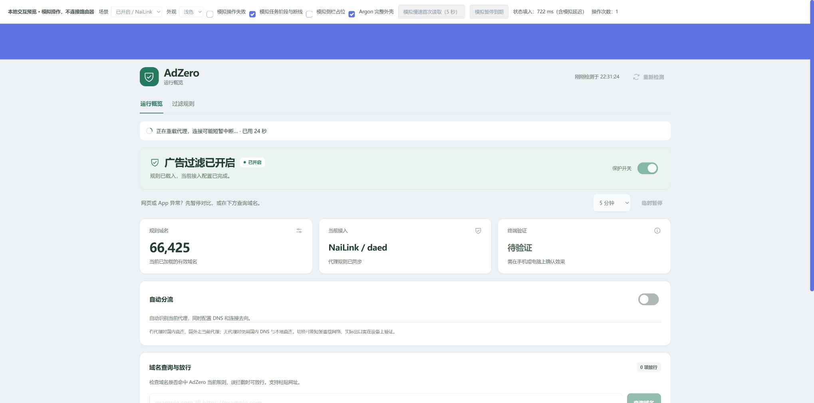

# v0.9.3 分流、订阅应用与后台同步优化

用户的分流任务超过 100 秒；任务记录同时表明一次分流成功，另一次规则变更因等待全局锁 30 秒失败。旧后台同步即使输入不变，仍逐条导入、校验、排序广告表，生成 DAT 并重读国内分类；规则启用又对未变化的来源做重复预检。

- 规则导入、订阅格式及国内分类校验把循环内正则移到循环外复用，保留原校验语义。
- 新增临时解析缓存。原始输出 SHA-256、解析模式、缓存内容 SHA-256 和数量一致时复用严格导入结果；损坏、不可用、权限不符、内容或模式变化时重新严格解析。缓存不是后端运行证明，实时服务状态、错误和解析器检查继续执行。缓存位于 `/tmp/adzero-rules-cache`，重启后可重新生成，不包含节点配置。
- 同步只在规则内容、相关配置、原生依赖文件、自有文件、UCI 标记及 NaiLink 选中 profile 均符合既有记录时跳过重建。PassWall 分类表变化、Nikki core_only/运行配置变化、外部编辑和代理切换会重新进入原适配流程。新缓存记录兼容旧恢复日志，不能覆盖并发修改。
- 国内派生文件只有在固定源版本匹配、实际内容等于恢复记录时才复用。NaiLink 正常分流切换仍一次核心重载，不将任务提前标为成功。
- 添加/启用只预检变化的订阅，明确刷新才检查所有启用项；后端仍执行实际下载与合并，最终规则上限和恢复检查保留。没有通过增加锁等待上限或移除互斥保护掩盖排队。
- 旧订阅自动识别三种支持格式并保存校验数量和检查时间；原 URL、原生格式与启用选择保留。不能独立识别的格式标为「未独立计数」，由后端继续处理。
- 任务记录保存不含参数的动作名与固定阶段时间线。页面分别显示总用时和当前阶段用时，避免将整段等待/校验时间都误认为代理重载时间。

隔离性能用例包含 206,375 条广告规则、109,795 条国内域名和 10,015 个 CIDR，运行生产控制器、真实 UCI/ucode。下载、后端服务和 NaiLink API/重载使用替身；用例记录冷/热分流、后台同步、查询和新增规则启用，不能代表 ARM 路由器或真实核心的耗时。对照源为 v0.9.2 提交 `ac1841efd3ceaf5d986fde5d097210348e877052`。最终计时、SDK 与原生回归证据见 [LOCAL_VALIDATION.md](LOCAL_VALIDATION.md)。

# v0.9.2 大规则量状态读取修复

用户设备的 206,375 条规则已正常载入，但 `ctl status` 实际耗时 29.62 秒，`ubus -t 10 call file exec` 在 10 秒超时。页面未取得新状态，因而禁用开关。此前小规则夹具和固定控制器 RPC 测试没有覆盖这一规模。

根因是页面每次读取状态都会走 `backend ready`：重新解析、规范化、去重并排序整份处理后规则。现在状态读取调用 `backend inspect`，核对实时服务状态、错误、解析器运行情况、DNS 模式、输出路径、文件存在与大小；规则数量来自后端本次运行的 entries 元数据。`rules_checked:false` 明确表示此次读取没有逐条验证规则内容。客户端 DNS/连接出口仍保持未验证。

启用、更新、恢复、放行和后台同步的完整校验保持原样，`backend ready` 仍解析实际规则。输出文件缺失、解析器停止、后端报告错误或路径不匹配仍使概览异常；状态读取不下载、不重启服务、不占操作锁。没有通过延长 RPC 超时掩盖慢操作。

同一 WSL 原生 ucode/UCI 夹具（206,375 条、5,365,750 字节规则与约 7 MB 恢复记录）中，`ctl status` 从 10.98 秒降至 0.34 秒。真实 rpcd/ubusd 的隔离 chroot 以 1 秒执行上限，通过生产控制器的同规模状态读取；procd 服务数据为夹具，未运行真实代理或 DNS 服务。这些耗时不是用户 ARM 路由器测速。

状态读取失败时，页面顶部保留具体错误详情入口，避免把所有失败都描述为连接中断。升级后刷新页面，再运行 `time /usr/libexec/adzero/ctl status` 记录实际设备耗时。此修复针对页面读取和由此导致的禁用；首次规则下载、完整校验与代理重载仍有实际耗时。

# v0.9.1 开关响应与 NaiLink 兼容性修复

用户真机日志为 `Expected one dae DNS routing.response`。旧适配器把 response 段当成必填，漏掉了合法的 request-only 配置；失败后虽然恢复了原设置，却造成重复等待。现在允许省略 response，只在原配置包含该段时增加自有上游的 accept 规则。两种配置分别经过真实 dae validate 检查。

参考：[dae v2.1.1 官方默认示例](https://github.com/daeuniverse/dae/blob/v2.1.1/example.dae)。本地事务使用真实 ucode/UCI，代理/API 仍为明确的测试夹具，不代替路由器和 LAN 验收。

## 减少重复工作

- NaiLink 切换分流前先检查选中配置、当前原值和目标语法，再通过同一份恢复记录修改 DNS 和流量 profile。正常切换只重载一次代理，过滤后端保持运行。部分更新失败时恢复最近有效的两份 profile。这个优化仅针对 NaiLink，其他适配器保留原有事务路径。
- 关闭分流时保留自有分类数据作为下一次切换缓存，完整关闭保护时移除。
- 关闭或删除订阅不再预下载所有剩余来源；后端仍会重新生成规则。新增、开启和手动刷新继续校验。
- 重新开启保护时，只有后端配置模型相同、原生缓存文件 SHA-256 与上次成功输出相同，才允许使用缓存恢复；配置或内容变化则重建。仅适用于已知 dnsmasq.servers / dnsmasq.addnhosts 缓存路径。缓存证明文件权限为 0600，可能包含原有订阅配置，不应公开分享。

## 任务状态与重连

点击后立即显示具体操作。任务回执反馈等待锁、检查、下载、校验、处理、适配、重载、恢复及验证阶段，并显示服务端用时。阶段不是进度百分比，也不代表应用成功。

轮询断线时显示“连接暂时中断，正在继续追踪原任务”，最多连续重试 15 次，间隔 2 秒。持续不可达时保留原回执，概览标为旧状态，禁用新写操作；点击“重新检测”继续核对同一任务，不重复提交。任务完成后的状态读取另允许 5 次短重试。最长轮询窗口到期也保留回执。

已停止且没有完成回执的后台进程会显示中断状态，不会一直假装执行；任务完成与进程退出的竞争窗口会再次读取结果文件。不会因进程消失就删除操作锁或恢复记录。

公开阶段及错误原因使用固定词汇，原始日志、域名参数和订阅令牌不进入回执。预览中的“模拟任务阶段与断线”只操作本地模拟状态，不连接路由器。

## 设备验收

1. 用本次 request-only NaiLink 配置开启分流，确认不再出现 response 缺失；记录实际核心重载次数、总用时、DNS 与连接出口。
2. 重载过程中短暂断开浏览器，确认页面继续核对原任务；持续断线后使用“重新检测”，确认没有第二项写操作。
3. 比较冷缓存、热缓存、规则/个人放行变化、手动更新、缓存损坏和重启。热缓存保持过滤效果，变化后不得恢复旧规则。
4. 记录等待锁、下载、处理和重载各阶段。下载与服务重载仍需要实际时间，本版不承诺固定秒数或已经完成真机性能验证。

