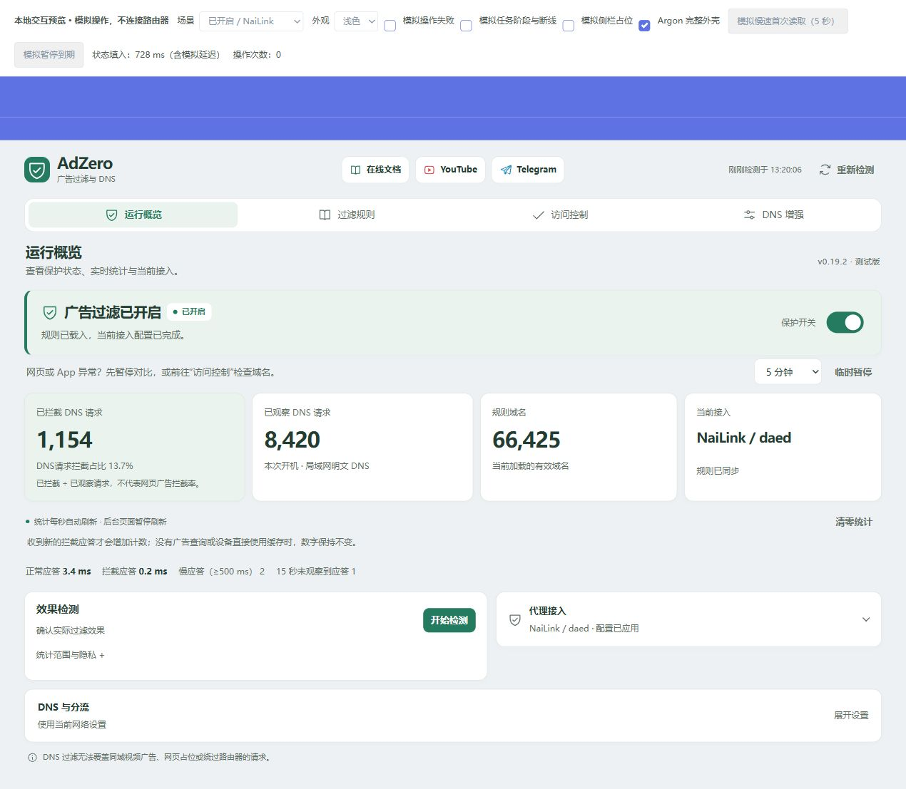

# v0.19.2：统计含义与别名过滤补漏

概览将“拦截比例”改为“DNS请求拦截占比”，在卡片内说明“已拦截 ÷ 已观察请求，不代表网页广告拦截率”。累计计数与清零口径保留，不把未拦截的正常请求称为漏掉的广告。

## 修正与范围

- `dns-enhance-lib.uc`：在已启用且受支持的增强入口，补充同类型 HTTPS/SVCB AliasMode（优先级 0）别名检查；设备附加规则也检查可达的别名目标。只沿当前问题的应答链，保留放行例外；不把 ServiceMode、无关记录或附加区当作需要拦截的别名。
- `observe-lib.uc`：识别 IPv6 回环 `::1` 阻断应答；截断应答不再算作“命中规则仍返回正常 IP”的证据，减少漏拦误报。超时、SERVFAIL 和未观察到的应答仍不计为拦截。
- `overview.js` / `overview.css`：新统计名称、低层级简短说明；增强计数改为“别名拦截”，与主规则 A/AAAA 被动统计分别展示。
- `check_passwall_runtime.py`：测试依赖的 timeout 包摘要按 OpenWrt 官方包索引更新，保留固定 SHA-256 校验，修正冷缓存 CI 检查失败。

增强入口仍仅支持确认的默认 IPv4 系统 DNS 或 PassWall 路径，默认关闭。NaiLink、OpenClash/Nikki、严格模式、未知 ACL 和代理切换期间不叠加该入口，保留原生路径与现有基础过滤。不更换代理引擎、节点或用户 DNS，不自动扩大防火墙阻断范围。

## 验证

[验证摘要](evidence/v0.19.2/summary.json)记录 537 项 Python 测试、341 项界面断言、五项在线文档测试、三个官方 SDK 构建和六组 LF/CRLF 安装器交付检查。

真实 OpenWrt ucode、dnsmasq、socket 与 nft 在独立命名空间中验证 UDP/TCP 别名拦截、设备隔离、普通 ServiceMode 保留、原生连接与 DNS 进程保留、增强入口退出恢复；同时回归各代理适配、统计采集、严格模式及 DNS 交接。IPv6、旧 UDP/TCP 映射和代理切换保持原有边界，不通过全局清连接来掩盖问题。

桌面和 360 像素手机浏览器检查实际 LuCI DOM 的统计卡片，RPC 为模拟。没有连接或修改用户路由器；上述测试不等同于家庭网络、浏览器 DoH 或全部网站广告的实机验收。实际漏拦应按“域名命中 → 终端效果检测 → 当前接入与 DNS 路径”定位。

发行目标：OpenWrt 24.10.8 x86/64 IPK、25.12.5 x86/64 APK、25.12.5 rockchip/armv8 APK。没有新增运行依赖。保护范围见 [DNS 设置](DNS_SETTINGS.md)，AliasMode 语义见 [RFC 9460](https://www.rfc-editor.org/rfc/rfc9460.html#section-2.4.2)。

