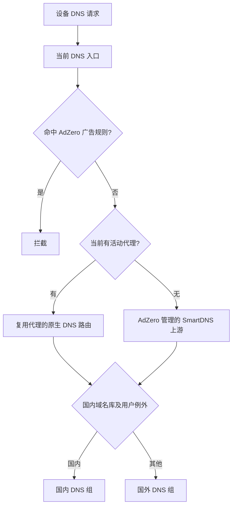

# 智能 DNS 双模式设计

状态：已确认的开发范围，尚未随 v0.8.2 安装包启用。当前包仍只提供广告域名过滤。以下是实现和验收约束，不能作为已完成的设备功能说明。

用户目标：有 NaiLink、PassWall、OpenClash 或 Nikki 时自动适配；没有代理时也能独立完成国内/国外域名分流和广告过滤。主页面只增加「智能 DNS」开关，默认先检查当前链路；国内上游、国外上游与域名例外放入按需展开的设置。

## 解析路径

DNS 选择影响地址解析和 CDN 分配；后续连接是否走代理仍由现有代理路由决定。国外 DNS 的传输是否经过代理，需要另行验证，不能由 DNS 地址或「国外」标签推断。无代理时不提供科学上网能力。

## 各环境的实现入口

| 环境 | 入口 | 保留与验证 |
| --- | --- | --- |
| NaiLink / daed | 选中 DNS profile 的 upstream、routing.request；广告 reject 继续位于分流前 | 复用同一恢复日志，保留原请求/响应规则、节点引导解析和已有 packet routing；调用 parsedDns 后再提交；真实 eBPF 请求另测 |
| OpenClash | 当前 custom_overwrite 对生成配置增加域名 provider 与 nameserver-policy | 保留原订阅、策略组、Fake-IP 模式及用户例外；核心检查和实际查询同时通过；处理规则重叠优先级 |
| Nikki | 原生 mixin 与最终生成配置 | 处理 UCI 后置 DNS 数组覆盖；core_only、不能等价保留的配置拒绝修改；校验最终配置而非只看 mixin 文件 |
| PassWall | 对照当前版本的 DNS 生成器、国内/远程上游与现有列表模式 | 不能将 chn_list=direct 当成纯 DNS 开关，它也参与 ipset/nftset 路由；尊重 ACL、用户直连/代理列表；不能安全组合时明确给出原因 |
| 无代理 | dnsmasq/adblock-fast 为前端，独立 SmartDNS 作为回环上游 | 不接管已存在的 SmartDNS/AdGuard Home；不改客户端 DHCP、监听 53 或增加 DNS 劫持；启动并查询新上游成功后才切换转发 |

SmartDNS 仅在独立模式需要时使用固件对应软件源的原生包，不捆绑跨 CPU 的二进制，不增加另一套 Web 后台。OpenWrt 24.10 的 SmartDNS 版本较旧，生成配置必须以该版本支持的选项为下限，不能照抄最新版示例。

## 规则和故障语义

- 国内域名使用维护的域名库，记录来源、版本和下载哈希；`.cn` 后缀不能代替完整域名分类。域名库单独管理，不进入广告订阅列表。国内/国外归类是策略选择，不是服务器地理位置证明。
- 广告过滤优先；分流不能通过更精确的域名转发记录绕过被拦截的父域。尤其不要直接把国内 server=/domain/IP 混入 dnsmasq 的广告 server=/parent/ 文件。独立上游分层可避免这类优先级冲突。
- 显式用户例外、局域网名称、反向解析、节点/DoH 主机的引导解析需要单独保护；拒绝回指自己的入口，防止循环。引导地址不能依赖尚未就绪的新分流链路。
- 各组内可故障切换；国外失败不默默转交国内组，避免污染和隐私语义改变。失败时保持最近有效配置，或恢复安装前的转发路径并明确显示；不显示「分流已验证」。
- 先下载、验证和启动，后切换；关闭、卸载与升级先恢复入口，再停止自有后端。恢复日志记录原值、应用值和阶段，并检查并发修改。与广告开关、暂停、恢复、代理切换使用同一控制器锁，不能另建互相覆盖的 DNS 日志。
- 默认只显示当前模式和可操作结果，不显示虚构加速百分比、流量统计或未经测量的命中次数。

## 发布前的必要验证

1. 用两个分别记录请求的回环 DNS 上游，证明国内、国外及自定义例外分别到达预期组；同时覆盖 A、AAAA、UDP、TCP、缓存未命中和命中。
2. 广告域名同时出现在国内库、国外例外、被拦截父域的子域等重叠情况下，过滤结果仍符合统一策略；放行和撤销后分流仍正确。
3. 四个代理与独立模式分别覆盖启用、暂停、恢复、更新、关闭、升级、重启、切换代理、下载失败、上游失败及外部配置编辑。
4. 真实核心的配置解析不等于流量验证；Fake-IP 响应也不能证明真实上游已查询。代理需观察真实上游请求，NaiLink 另验 LAN/eBPF。
5. 继续使用准确版本与 target 的 SDK 矩阵；依赖包、固件服务生命周期和真机/LAN 验收分开记录。没有实际测量时不承诺所有网站更快。

## 参考基线

- [SmartDNS 分流](https://pymumu.github.io/smartdns/config/domain-forwarding/) 与 [代理上游](https://pymumu.github.io/smartdns/config/proxy/)。
- [OpenWrt 24.10 SmartDNS 包](https://github.com/openwrt/packages/blob/openwrt-24.10/net/smartdns/Makefile)：1.2023.43 / 1ba6ee7cb98b5b6448bc2a2be318eb3518d4de79，原生 libopenssl 依赖。
- [dae DNS](https://github.com/daeuniverse/dae/blob/main/docs/en/configuration/dns.md)；实现需同时使用现有固定核心检查，不能把浮动文档当成旧版本能力。
- [Mihomo DNS](https://wiki.metacubex.one/config/dns/)；nameserver-policy、引导解析和 Fake-IP 分别检查。
- [PassWall 固定提交](https://github.com/Openwrt-Passwall/openwrt-passwall/tree/ae258e4da46aa34567230f55e401ced4cb7738ad/luci-app-passwall/root/usr/share/passwall)：app.sh、helper_dnsmasq.lua、helper_smartdns_add.lua。
