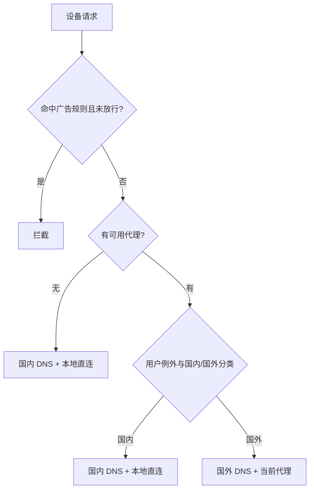

# AdZero 自动分流与广告过滤

状态：v0.9.0 公开测试实现。由 AdZero 自己编译广告、DNS 和连接策略，复用 dnsmasq 与现有代理；未新增 SmartDNS、AdGuard Home、代理内核或常驻解析引擎。SDK/配置事务、真实核心隔离测试与路由器验收分开记录，不能相互替代。

## 用户需要的行为

由 AdZero 统一判断、维护规则和自动切换。用户开启后，不必另行安装、登录或配置 SmartDNS、AdGuard Home；这两个项目仅用于参考解析分组、缓存、规则管理和误杀恢复等体验。

| 网络状态 | 目标 | DNS 选择 | 实际连接去向 |
| --- | --- | --- | --- |
| 有可用代理 | 国内目标 | 国内 DNS | 默认本地直连 |
| 有可用代理 | 国外目标 | 国外 DNS，结合当前代理的传输能力 | 默认当前代理 |
| 无可用代理 | 所有未被拦截的目标 | 国内 DNS | 本地宽带直连 |
| 任意状态 | 命中广告过滤规则且未放行 | 在当前过滤链路拦截 | 不因分流规则绕过拦截 |

「无代理走国内」指国内 DNS 与本地网络出口。国外域名仍可按普通直连方式访问，不额外强制使用国外 DNS，也不向不存在的代理入口转发；能否连通取决于实际网络。

局域网名称、私有地址和用户明确指定的分流例外需要保留。表中是自动模式的默认行为；个人广告放行只解除 AdZero 的对应拦截，不自动改变该域名的直连或代理选择。

## 一套策略，同时协调 DNS 和流量

只更换解析服务器不足以实现这张表。AdZero 需要把同一份策略分别转换为 DNS 选择与实际连接路由，并核对两者的应用结果。国外 DNS 地址、Fake-IP 响应或代理进程存在，都不能单独证明连接已走代理。

AdZero 负责策略、分类数据、广告规则、代理能力识别、配置同步、状态切换和恢复。DNS 处理复用固件已有基础能力；已有代理插件继续承担实际代理转发。无需为了该功能再运行 SmartDNS、AdGuard Home，也不在 AdZero 中重新实现一套代理内核。

## 四种代理的适配范围

| 环境 | 当前接入 | 保留与限制 |
| --- | --- | --- |
| NaiLink / daed | 协调当前 DNS profile 与实际流量路由，验证对应 eBPF 路径 | 用户节点、选中策略、局域网规则、显式例外及原有 DNS 引导解析 |
| PassWall | 协调原生 DNS 生成器与直连/代理规则；区分全局默认与设备 ACL | 节点和凭据、设备 ACL、用户列表；不能把 chn_list 当成纯 DNS 选项处理 |
| OpenClash | 在原生扩展入口协调 DNS policy 与连接 rules，使用实际存在的代理策略 | 订阅原文、用户策略组、显式例外、TUN/Fake-IP 模式；不能猜策略组名称 |
| Nikki | 协调原生 mixin、DNS 与连接规则，并检查最终生成配置 | 用户订阅、策略、设备设置；处理 UCI 后置混入，不能只检查 mixin 文件 |
| 无代理 | 恢复或使用固件现有 DNS/直连路径，国内上游解析与广告过滤继续工作 | 局域网解析、DHCP、已有用户设置；不遗留国外 DNS 或旧代理转发入口 |

v0.9.0 的具体实现：

- NaiLink：读取唯一选中 DNS 与流量 profile，确认 fallback 对应真实代理组，写入自有 GeoSite/GeoIP DAT；同时更新 DNS request/response 和连接路由。保留已有明确规则，恢复时比对原值。dae 真正停止时只恢复 profile，不主动启动内核。
- PassWall：使用原生国内域名/IP 数据和 DNS/防火墙生成器，设置国内直连、默认远端解析、远端 DNS TCP 与当前节点；保留节点、凭据、设备 ACL、用户列表和端口范围。只接受具备相应原生能力、country 数据及受支持 DNS 模式的版本，能力不符即拒绝。该路径已验证 UCI 事务与恢复，尚缺真实 PassWall 生成器及路由器出口实测；不能承诺任意分支等价支持。
- OpenClash：保留原生 custom_overwrite 脚本，经生成配置中的终结 MATCH 确认真实代理组，把国外 DNS 传输绑定该组；国内域名/IP 默认 DIRECT。调用现有 Meta 核心校验，订阅原文不变。
- Nikki：使用 mixin 与 nikki-rules，处理 UCI 后置 DNS 混入并检查最终配置。用户在 nikki-rules 中的显式例外在前，自有国内默认规则随后，订阅 rules 在后；因此订阅中针对国内目标的例外应移入用户 nikki-rules 才能维持优先级。不会把当前订阅策略组冻结到自有文件。
- 无代理：仅管理单个启用的 dnsmasq 实例，保留条件域名 server，替换默认上游为国内池并设置 noresolv，防止再次使用旧默认外部 DNS；不改变 DHCP、监听端口或自行添加防火墙。多个实例、其他 DNS 引擎或代理遗留强制转发需要先检查，不能承诺接管所有请求。

国内默认上游为 223.5.5.5、119.29.29.29；国外默认为经当前代理传输的 TCP 1.1.1.1:53。第一版不提供任意上游编辑。用户已有明确 DNS/路由例外优先，广告放行不修改分流。广告与国内子域规则重叠时，适配器补齐拒绝域名，避免更具体的 dnsmasq server 或 Mihomo DNS 策略绕过父域拦截。

国内分类使用 felixonmars/dnsmasq-china-list 与 Loyalsoldier/geoip 的固定提交、严格 HTTPS 与 SHA-256 校验；只提取域名/IP，不使用来源文件中的 DNS 地址。首次下载可能耗时，后台任务完成后才更新状态。当前校验数据为 109,795 个域名、10,015 个 CIDR（其中 3,488 个 IPv6）。来源和校验值保存在生产模块 routing-lib.uc。

## 自动切换和恢复

- 区分「已安装」「配置启用」「进程运行」「代理路径可用」。安装了插件不代表现在可以使用代理；无法确认时显示未确认，不虚报分流成功。
- 无可用代理时，目标状态为国内 DNS 与本地直连。重新具备可用代理后，再恢复国内直连、国外代理的默认分流。后台检查需要防抖，不能因一次探测超时反复重启网络。
- 自动模式的切换范围只包括 AdZero 自己管理的入口。其他工具明确设置的禁止直连或自定义路由，不能通过清空防火墙、改节点或覆盖整个配置来绕过；冲突时显示实际状态。
- 使用现有控制器锁与恢复记录协调 DNS、广告过滤和连接规则。先记录原值与应用意图，再修改；失败恢复最近有效状态，遇到外部并发编辑则保留记录。
- 关闭、升级或卸载要移除自有接入并恢复原设置。代理切换、退出或故障后，不能残留指向旧代理的 DNS/连接规则。
- 国内分类使用维护的域名与 IP 规则，不能只看 .cn 后缀。分类数据与广告订阅分别管理，明确优先级和未分类目标的默认策略。

## 界面目标

首页提供保护总开关与「自动分流」开关。自动分流是保护中的可选功能，默认关闭，只在保护已开启时可修改。关闭分流保留广告过滤；关闭保护或临时暂停会恢复两者的自有配置，保留分流选择，重新开启时恢复选择。自动分流开启后自行匹配环境，显示「国内直连 / 国外代理」或「国内 DNS / 全部直连」。用户不需要手选 NaiLink、PassWall、OpenClash 或 Nikki。

默认路径不要求填写服务器、端口或策略组；高级上游编辑留待后续。状态只显示配置应用结果，不把运行进程或已保存选项当成实际出口验证。

## 验证结果与仍需验收

- 原生 OpenWrt ucode/BusyBox/UCI 事务测试覆盖四适配器、无代理、失败回滚、暂停/恢复、停止代理后不重启、手动修改保护等。
- 真实 Mihomo v1.19.32 的 54 项独立网络命名空间检查覆盖 redir-host/Fake-IP、UDP/TCP A/AAAA、国内/国外解析、广告优先、HTTP 实际直连/代理、IPv4/IPv6。DNS、SOCKS、HTTP 目标是命名空间内的本地夹具；不是公网延迟测评。
- 真实 dae v2.1.1 validate 通过 DNS/连接 DSL 与生成的 v4/v6 数据文件。该命令不等于 eBPF、NaiLink API、LAN 路径实测。
- 真实 rpcd 的 1 秒超时隔离测试确认分流任务独立执行并释放锁。
- 无代理的国内默认 DNS、四适配器配置应用和恢复通过本地事务测试。代理中途断网、节点不可达或路由器遗留防火墙规则仍须真机验收。

后台每 60 秒协调配置。当前只判定选中配置、核心运行与原生能力，**未实现节点端到端健康探测**。代理停止可切换到国内模式；进程活着但节点失联不会被误报为已经完成安全降级。状态中的 traffic_verified 始终为 false，直至另有真实设备证据；本版不宣称全面自动故障切换或已验证访问加速。

可重复运行 scripts/check_routing_core.py、check_routing_dae.py、check_routing_data.py；前者需要 Linux root，仅用于创建私有网络命名空间。

## 正式版前的设备验收要求

1. 无代理时，国内、国外的未拦截目标都使用国内 DNS 和普通直连；广告过滤仍有效，没有国外 DNS 或旧代理入口残留。
2. 四种代理分别验证国内 DNS/直连、国外 DNS/代理；记录实际 DNS 上游及实际连接出口，不能只检查配置文本。
3. 覆盖启用、暂停、恢复、代理关闭/故障/恢复、切换代理、更新、升级、重启与卸载，验证自动切换和原配置恢复。
4. 覆盖广告与分流规则重叠、个人放行、局域网名称、节点引导解析、显式用户例外、设备 ACL、IPv4/IPv6 及各代理的实际工作模式。
5. 多代理冲突、未知插件/核心、不能表达等价策略或配置被外部修改时，给出明确状态，不猜测当前网络出口。
6. SDK、核心隔离测试和真实路由器/LAN 验收分开记录；不因配置解析通过就宣称连接分流、广告效果或访问加速已验证。

## 旧 SmartDNS 实验的定位

此前 28 项 SmartDNS＋dnsmasq 隔离检查保留为历史技术实验：[脚本](../scripts/check_smart_dns_design.py)、[原始结果](evidence/smart-dns-design/result.json)。它只验证写死配置下的 DNS 分组、过滤优先级、缓存与故障隔离，没有调用 AdZero 的生产事务或四代理连接分流。

该实验不再决定产品架构，不是新增 SmartDNS 依赖的理由，也不能作为修订后自动分流功能的验收证据。当前安装包没有因此增加 SmartDNS、AdGuard Home 或其他大型依赖。
